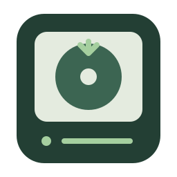
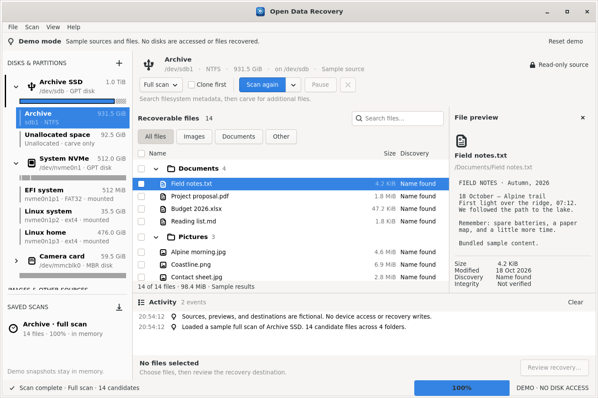

<p align="center">
  
</p>

<h1 align="center">Open Data Recovery</h1>

[](LICENSE)
[](Cargo.toml)
[](Cargo.toml)
[](docs/packaging.md)

> A native GTK data recovery application for Linux — scan disks and images, review recoverable files, and restore selected contents with verification.

Open Data Recovery (ODR) brings Sleuth Kit, TestDisk, PhotoRec and other recovery tools into one interface, with read-only source access, persistent scans and optional duplicate consolidation.

[Features](#features) · [User Guide](docs/wiki/README.md) · [Installation](#installation) · [Usage](#usage) · [Building from source](#building-from-source)



*Demo mode with fictional sources and files. The application uses your system GTK theme.*

## Features

- Disk and partition layout with support for raw/dd and E01 images, unlocked mappers and mounted local folders
- Quick metadata scans, Deep content carving, and Full scans combining both
- Custom scan filters, engine selection, byte ranges, timeouts and clone-first options
- Read-only TestDisk lost-partition discovery, with saved reports and bounded partition scan targets
- Persistent SQLite scans, selections, engine records and activity logs; reopen, compare or delete saved scans
- Optional final consolidation of byte-identical findings, preserving all recorded names and engine details
- Search, file-type filters, folder selection, and image/text previews
- Recovery options for folder structure, filename conflicts, timestamps and SHA-256 output verification
- Native GTK4 interface with system light/dark themes, plus a CLI for scanning and recovery

| Scan mode | What runs |
| --- | --- |
| **Quick** | Applicable metadata engines run sequentially to find filesystem records and recoverable files. |
| **Deep** | One carving engine searches file contents for supported signatures. |
| **Full** | The metadata plan runs first, followed by one carver. |

Without consolidation, findings from different engines remain separate. **Custom… → Consolidate identical files when the scan finishes** groups verified identical contents after scanning; it is off by default and can require additional time and workspace. See [scan modes](docs/wiki/scan-modes.md), [engines](docs/wiki/engines.md) and [consolidation](docs/wiki/consolidation.md).

Filesystem support covers **ext2/3/4, btrfs, FAT12/16/32, exFAT and NTFS**. XFS, APFS and HFS use best-effort carving. ZFS and locked encrypted volumes are unsupported; select an already-unlocked mapper for encrypted media. Results depend on filesystem damage and installed engines.

## Installation

Release packages target Linux x86_64: Debian/Ubuntu (`.deb`), Fedora (`.rpm`), Arch (`.pkg.tar.zst`) and AppImage. See [GitHub Releases](https://github.com/fossgap/open-data-recovery/releases) for published artifacts, or [build packages locally](docs/packaging.md).

<details>
<summary>Requirements</summary>

- Linux 6.2 or newer with Landlock ABI 3 enabled for backend write confinement
- glibc 2.36 or newer; GTK 4.8 or newer for native packages
- Sleuth Kit, TestDisk/PhotoRec and GNU ddrescue for the default toolset
- UDisks2 and polkit for read-only device access as a normal user
- Additional installed tools for [optional recovery engines](docs/wiki/engines.md)

Native package managers resolve declared dependencies. The AppImage bundles GTK and its runtime assets; recovery engines remain host dependencies. **Help → Backend availability** reports detected tools and versions. No engines are downloaded during a scan.

</details>

```sh
# Debian / Ubuntu
sudo apt install ./open-data-recovery_*_amd64.deb

# Fedora
sudo dnf install ./open-data-recovery-[0-9]*.x86_64.rpm

# Arch Linux
sudo pacman -U ./open-data-recovery-[0-9]*-x86_64.pkg.tar.zst

# AppImage
chmod +x OpenDataRecovery-x86_64.AppImage
./OpenDataRecovery-x86_64.AppImage
```

Optional `open-data-recovery-engines` packages provide pinned RecuperaBit, Digler and ext4rescue builds. See [packaging](docs/packaging.md) for dependencies, additional packages and running AppImage without FUSE.

## Usage

1. Select a disk or partition, or use **File → Add source** for an image or mounted folder.
2. Choose **Quick**, **Deep** or **Full**. Click **Scan** for the defaults, or its dropdown → **Custom…** for workspace and engine options.
3. Review the results, filter or preview candidates, and select the files to restore.
4. Open **Review recovery**, choose the destination and recovery options, then recover the selected files.
5. Use **Scan → Saved Scan** to reopen, compare, scan again or delete saved attempts. For missing partitions, start with **Scan → Find lost partitions…**.

Device and mounted-folder sources require workspace and destination storage on a different physical drive. Regular image files may share their hosting drive, provided neither output folder contains the image or any of its segments. The recovery destination must also be outside the saved scan folder.

The workspace can contain extracted files, a clone and consolidation caches; recovery writes separate selected copies to the destination. Some metadata engines already extract contents during Quick scanning. See [storage and cleanup](docs/wiki/storage.md) and [how recovery works](docs/wiki/recovery.md).

Try the interface without accessing sources using `open-data-recovery --demo`. For CLI options, run `open-data-recovery --help`.

## Building from source

Source builds require Rust 1.85+, a C compiler, `pkg-config` and GTK4 development headers. From the repository root:

```sh
# Debian / Ubuntu build dependencies and default recovery tools
sudo apt install build-essential pkg-config libgtk-4-dev sleuthkit testdisk gddrescue udisks2

cargo run --locked                    # Launch the application
cargo run --locked -- --demo          # Run with fictional data
cargo test --locked                   # Unit tests
sh scripts/check.sh                  # Build, layouts and GTK smoke checks; requires Xvfb
cargo build --release --locked
sh scripts/package.sh deb            # Also rpm, arch, appdir; outputs go to dist/
```

The included Debian Bookworm Dockerfile provides a GTK 4.8 development environment:

```sh
docker build -t open-data-recovery-dev .
docker run --rm --tmpfs /tmp:rw,exec open-data-recovery-dev
```

See the [development guide](docs/development.md) for real-engine and GUI checks, [packaging](docs/packaging.md) for portable builds, and [Repository Guidelines](AGENTS.md) for contribution conventions.

## Powered by

- [Sleuth Kit](https://www.sleuthkit.org/sleuthkit/) — filesystem metadata discovery and extraction
- [TestDisk / PhotoRec](https://www.cgsecurity.org/) — lost-partition discovery, NTFS undelete and file carving
- [GNU ddrescue](https://www.gnu.org/software/ddrescue/) — source cloning with a retained recovery map
- [GTK](https://www.gtk.org/) and [gtk-rs](https://gtk-rs.org/) — native Linux interface
- [SQLite](https://sqlite.org/) — persistent scan catalogues and selections

See the [complete engine guide](docs/wiki/engines.md) for additional backends and their roles.

## License

Open Data Recovery is licensed under [GPL-3.0-only](LICENSE). External recovery engines and bundled dependencies retain their respective licenses.
