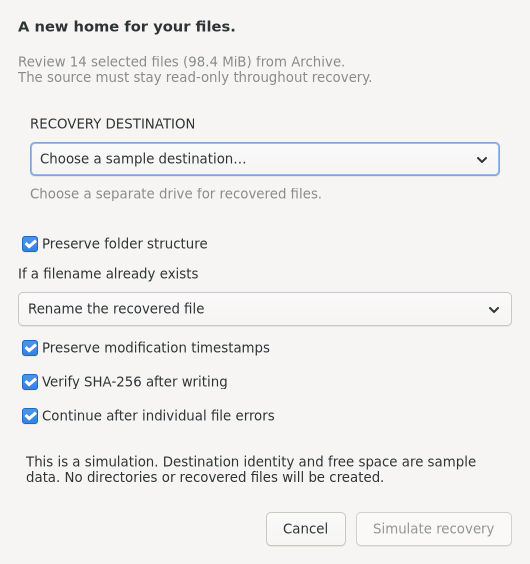

# Open Data Recovery

A native Linux workspace for **choose a source → scan → inspect and select files → recover to a separate drive**. Built with Rust, GTK4, and declarative GtkBuilder layouts.

The interface uses the system GTK theme, including its light/dark appearance, fonts, and native widget styling. Custom Scan keeps its settings in compact **Scan**, **Engines**, and **Advanced** tabs.

The application now runs real recovery engines, stores scans in SQLite, and writes selected files with SHA-256 audit records. Run `--demo` for the separate, non-destructive fixture demonstration used in the screenshots.


## Run

Requires Linux **6.2 or newer with Landlock ABI 3 enabled**, GTK **4.8+**, and the recovery tools needed for the chosen scan. The kernel requirement allows the backend sandbox to deny writes and truncation outside approved output directories. Unavailable tools and unsupported storage topology produce explicit errors.

For a source build, install Rust **1.85+**, a C compiler, GTK development headers, and `pkg-config`:

```sh
# Debian / Ubuntu: build dependencies and the default recovery engines
sudo apt install build-essential pkg-config libgtk-4-dev sleuthkit testdisk gddrescue udisks2

# Fedora
sudo dnf install gcc pkgconf-pkg-config gtk4-devel sleuthkit testdisk ddrescue udisks2

# Arch
sudo pacman -S base-devel rust gtk4 sleuthkit testdisk ddrescue udisks2

cargo run --locked
```

All `.ui` files, styles, and demo artwork are embedded in the executable. Once dependencies are cached, add `--offline` to Cargo commands. Use the normal user account; UDisks/polkit can grant access to a **read-only device descriptor** when necessary.

```sh
cargo run --locked -- --demo       # Fixtures only: no source access or recovery writes
cargo run --locked -- --backends   # Installed tools, reported versions, executable hashes
cargo run --locked -- --sources    # Read-only device discovery as JSON
```

## Recover files

1. Select a disk or partition in the disk layout sidebar, or use **File → Add source** for a raw/dd image, E01 image, unlocked mapper, or mounted local folder. Mounted filesystems remain mounted. Their contents can still change while other applications use them.
2. Choose **Quick**, **Deep**, or **Full**. **Scan** starts with that mode's defaults. Its dropdown offers **Custom…** for extensions, workspace, engine selection, clone engine/retries, size filters, a byte range, timeout, PhotoRec settings, and an alternate btrfs tree root.
3. Choose a workspace on a **different physical drive from the original source**. The default is `$XDG_DATA_HOME/open-data-recovery/snapshots`, falling back to `~/.local/share/open-data-recovery/snapshots`; it is rejected if unsafe. Another partition of the source disk is not sufficient. Unknown network, overlay, or virtual shared-filesystem ancestry is rejected. No scan storage is initialized before this check.
4. Scans run in the background. Pause/resume controls the process group; cancel retains partial results. Status stays outside the full-height progress bar. Only a percentage appears inside it; engines without measurable progress use an indeterminate bar.
5. Search and filter the SQLite results. Lists contain at most 250 candidates per page. File, folder, and select-all controls apply to the current page; selections persist across pages, filters, and application restarts. Preview supports small images/text and metadata; a preview is not a guarantee of recovery.
6. **Review recovery** checks the destination and available space before enabling recovery. Choose whether to preserve folders and timestamps, rename or skip filename conflicts, reread outputs to verify SHA-256, and continue after individual errors. Existing files are never overwritten. Recover outside the saved scan folder, on storage separate from the original source.



The screenshots use explicitly labeled demo data. Production dialogs use real paths and validation.

**Menu → Scan → Saved Scan** opens a dedicated dialog. Choose a workspace, inspect recorded source identity, state, results and engine versions, open an attempt, compare attempts, or scan again into a new session. Retained clones can be reopened and rescanned without the original source. Restarting creates a new attempt; it does not edit the old candidate tree or resume an interrupted third-party process at its internal checkpoint.

| Shortcut | Action |
| --- | --- |
| Ctrl+O | Add source |
| Ctrl+R | Start default scan |
| Ctrl+Shift+R | Custom scan |
| Ctrl+S / Ctrl+Shift+S | Saved scans (Ctrl+S saves an in-memory snapshot in demo mode) |
| Ctrl+F | Search files |
| Ctrl+P / Ctrl+L | Toggle preview / activity |
| Ctrl+Q | Quit; a running job is cancelled and its partial results saved first |
| Escape | Close a dialog |

## Engines and filesystem scope

| Operation | Implemented adapters |
| --- | --- |
| Quick metadata | TSK `fls`/`icat`, `tsk_recover`, ext4magic, extundelete, ntfsundelete, RecuperaBit, btrfs restore, TestDisk scripted NTFS undelete, ext4rescue |
| Read-only diagnostics | debugfs, dumpe2fs, btrfs-find-root, TSK partition discovery |
| Deep carving | PhotoRec, Scalpel, Foremost, Digler, Magicrescue, recoverjpeg |
| Forensic extraction | bulk_extractor; feature reports are retained as artifacts rather than mislabeled as original recovered files |
| Clone-first | GNU ddrescue with map, or safecopy with bad-block report |
| E01 | ewf-tools metadata inspection and export to a retained raw image |

Automatic Quick scanning uses TSK where applicable, btrfs restore for btrfs, and available journal/MFT alternatives on ext3/4 and NTFS. Full runs metadata and content carving. Automatic carving prefers PhotoRec, then Scalpel, then Foremost. A custom engine choice runs that adapter. Extension and size filters apply to imported results; carvers may inspect and temporarily extract other file families.

The supported scope is **ext2/3/4, btrfs, FAT12/16/32, exFAT and NTFS**. **XFS is best-effort carving; APFS/HFS are read-only carving only.** ZFS and locked encrypted volumes are rejected. Select an already-unlocked mapper for encrypted media. A mounted folder limits Quick metadata results to its filesystem path; carving requires selecting the containing filesystem, because raw signatures cannot establish folder ownership.

Recovery quality depends on damage, overwritten blocks, filesystem features, and backend versions. In particular, TSK cannot recursively follow every deleted directory, RecuperaBit does not support NTFS compressed files, and older ext journal tools may reject newer ext4 features. Nonzero exits, timeouts, and partial scans are recorded as errors, not successful completion. A custom byte range is copied to the approved workspace before scanning. Specialized metadata adapters expect a partition source; TSK discovers partition ranges on whole-disk images.

Install additional tools using your distribution packages. Package names differ; **Help → Backend availability** lists the executables the application can actually run. [Packaging instructions](docs/packaging.md) include pinned native packages for RecuperaBit, Digler, and an ext4rescue build whose cache respects the approved workspace.

## Saved data and headless use

Each attempt contains `manifest.json`, `source.json`, `tree.sqlite`, `events.log`, and `artifacts/`. Selection is stored separately in `selection.sqlite`. Clone-first retains `clone/clone.img` and its map/report. E01 and custom ranges retain their normalized input images. Backend stdout and recovered artifacts stay with the scan. Recovery log entries contain output paths, byte counts, errors, hashes, and verification state.

The source fingerprint records drive identity and size, partition UUID/offset, filesystem UUID, and sampled image content. The image sample is an identity check, not a full-image integrity digest. Comparisons use the engine versions and executable hashes recorded with each attempt. Supported legacy tables are read without schema migrations. NTFS compound metadata addresses and partition byte ranges remain intact.

```sh
open-data-recovery --scan /media/evidence/disk.img \
  --workspace /media/recovery/scans --mode full --extensions jpg,pdf --clone

open-data-recovery --list /media/recovery/scans/SESSION

# Recover the persisted selection; use --ids 1,2 or explicit --all to select files.
open-data-recovery --recover /media/recovery/scans/SESSION \
  --destination /media/recovery/restored
```

## Build, test, and package

```sh
cargo test --locked
sh scripts/check.sh          # GtkBuilder validation + demo and production GTK smoke checks
sh scripts/check-engines.sh  # Real tools on disposable images; /tmp and /dev/shm must be separate
sh scripts/check-ui-recovery.sh # Full GTK recovery flow on a disposable image
sh scripts/capture-preview.sh

# Optional isolated GTK 4.8 development environment
# No host devices or privileged container are required.
docker build -t open-data-recovery-dev .
docker run --rm open-data-recovery-dev

cargo build --release --locked
sh scripts/package.sh deb   # Also: rpm, arch, appdir
```

The test suite covers parsing compound addresses, confinement of recovered paths, conflict behavior, same-storage rejection, backend write isolation, timeouts, legacy loading, recorded-version comparison, and GTK workflows. Disposable-image integration checks exercise actual undelete, cloning, source disconnection, saved-clone rescanning, SHA-256 verification, content carving, E01 normalization, NTFS reconstruction, and packaged optional engines when installed. They do not access physical devices or demonstrate recovery from every form of filesystem damage.

See [UI design](docs/design.md), [architecture](docs/architecture.md), [validation results](docs/validation.md), [packaging](docs/packaging.md), and the original [requirements](docs/requirments/). The existing `requirments` directory spelling is retained.

## Primary references

- [Sleuth Kit fls](https://www.sleuthkit.org/sleuthkit/man/fls.html) and [icat](https://www.sleuthkit.org/sleuthkit/man/icat.html)
- [TestDisk / PhotoRec scripted commands](https://www.cgsecurity.org/wiki/Scripted_run)
- [GNU ddrescue manual](https://www.gnu.org/software/ddrescue/manual/ddrescue_manual.html)
- [UDisks read-only device access](https://storaged.org/doc/udisks2-api/2.9.2/gdbus-org.freedesktop.UDisks2.Block.html)
- [RecuperaBit](https://github.com/Lazza/RecuperaBit), [Digler](https://github.com/ostafen/digler), [ext4rescue](https://github.com/epi/ext4rescue)
