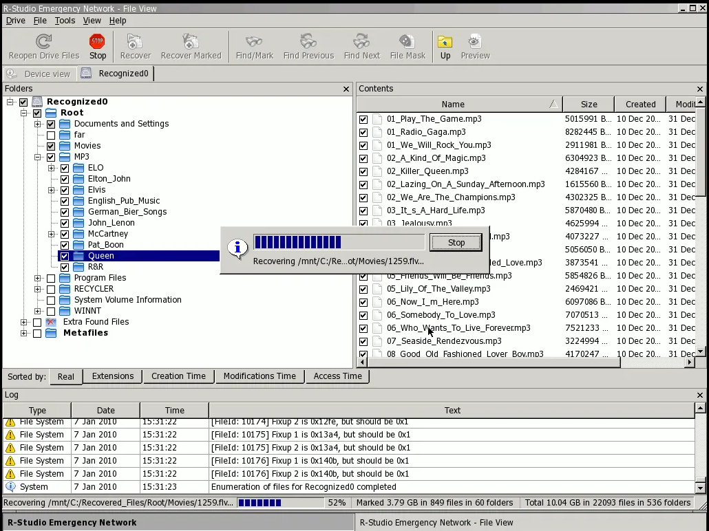
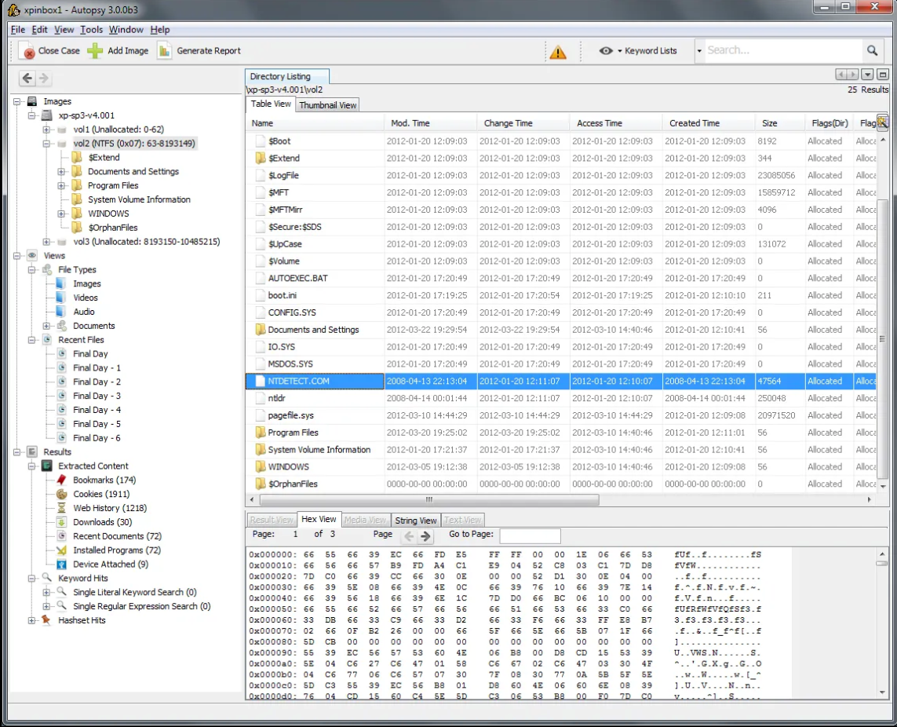
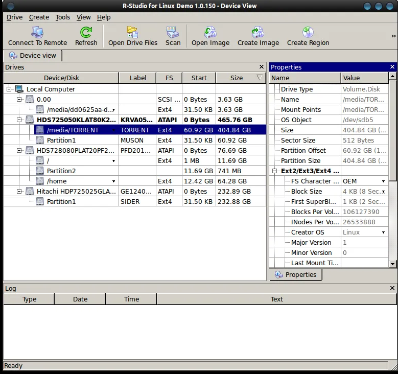

# open-data-recovery

Linux program for advanced and user friendly data recovery. Fills the gap left by CLI-only tooling (testdisk, photorec, sleuthkit, …) on Linux.

## Features

- User friendly UI
- Advanced data recovery

## Hard Requirements

- can recover deleted files,dirs from disk,partitions,disk image etc...
- User friendly flows:
  - Select Source(disks,partitions,folders etc...)
  - Scan
  - Present recoverable file tree (with preview)
  - User select file to recover
  - recover to a destination
- Scan snapshots (so user can reopen recent scans)
- live data recovery (on mounted device when possible)
- UI Layout and design
  - Menu bar
  - Toolbar (start,resume,cancel, mode etc...)
  - Left Panel (source management: listing,selection)
  - Main Panel (content display,vertical split for preview)
  - Info pannel (events display etc...)
  - Status bar (progress bar, status etc...)
- Performance and memory efficiency

## Brainstorming

1- data recovery on Linux is very not rich and most available tools are command line based. Linux users suffers for that lack of tooling compare to other platform like Window which have powerful proprietary tools like easyus, r-studio etc...

2- Goal is to propose a complete linux compatible solution aggregating and benefiting from existing tooling when appropriate.

3- Data recovery should be possible on most popular linux filesystems (ext2/3/4,btrfs etc...) and FAT, NTFS

4- In term of tech stack, i am thinking about the following:

- Java + Java-gi
- Rust + gtk-rs or gpui+gpui-kit
- C + gtk

Choose the one which suits the best?

5-  Is separate destination mandatory for data recovery?? if not allow same source and target 

6-First draft the UI layout so i can validate it before full implementation start

## Development and testing (Docker)

- docker, dev container 

## Packaging

native packages for Debian/Fedora/Arch plus AppImage

## Ressources

- [https://www.r-studio.com/data-recovery-software/?SOWCN000](https://www.r-studio.com/data-recovery-software/?SOWCN000)
- [https://github.com/cgsecurity/testdisk](https://github.com/cgsecurity/testdisk)
- [https://github.com/ostafen/digler](https://github.com/ostafen/digler)
- [https://github.com/sleuthkit/autopsy](https://github.com/sleuthkit/autopsy)
- [https://www.gnu.org/software/ddrescue/ddrescue.html](https://www.gnu.org/software/ddrescue/ddrescue.html)
- [https://foremost.sourceforge.net/](https://foremost.sourceforge.net/)
- 
- 
- 

