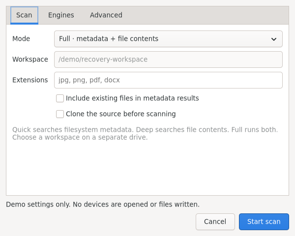
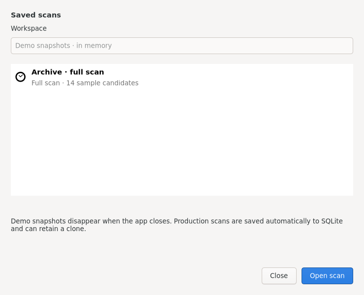

# Approved workspace and dialogs

The approved three-pane layout remains: physical disks and partitions on the left, a searchable file tree in the middle, and preview on the right. Activity is below the file list. A persistent recovery action summarizes selection. Preview, Activity, and split positions can be adjusted without leaving the workspace.

The interface follows the active GTK/system theme. Buttons, entries, checkboxes, lists, tabs and menus retain native GTK styling; there is no application color palette or forced font/light/dark setting. `ui/layout.css` only supplies spacing, the disk ancestry marker, and the approved progress-bar height. Custom disk maps take their foreground and selection colors from GTK.

The source list emphasizes disk ancestry. Partitions are indented below their parent, a capacity map reflects partition byte offsets and sizes, and both the selected partition and its parent disk are highlighted. Images and mounted-folder scopes are also selectable. Production discovery uses lsblk; demo fixtures exist only under `--demo`.

The footer separates status from progress. The right-hand progress bar fills the footer height, with **only the percentage centered inside**. Status and candidate counts remain outside. Unknown progress pulses without an invented percentage; pause/resume does not advance a simulated timer in production.

Source protection appears beside the source heading as a lock icon with the “Read-only source” label. Mounted sources retain that indication and add “mounted.” The sidebar protection section and separate protection text in the footer are removed. About is available in the Help menu.

## Scan dropdown

The main **Scan** action uses the selected Quick, Deep, or Full mode with default engine settings and the current workspace. The adjacent dropdown offers **Default** and **Custom…**.

The Custom Scan dialog opens at 600 × 480, with labels beside their controls and three native tabs. **Scan** contains the mode, workspace picker, extensions, existing-file inclusion and clone switch. **Engines** contains metadata/carving engine choices, PhotoRec options, clone engine and retry passes. **Advanced** contains size limits, source byte range, timeout and btrfs root. Every existing option remains available. Typed fields accept values, never shell commands. Invalid input remains in the dialog with an explanation. Starting validates physical storage before creating session files.

The same dialog also follows the [system dark theme](screenshots/custom-scan-dark.png). Tabs scroll when a larger system font needs more space.

## Review recovery

The dialog shows the selected file count and total size, then the destination and recovery options. Destination ancestry and free space are checked in a worker before the Recover action is enabled and checked again immediately before writes.

Options preserve folder structure and modification times, choose rename/skip for conflicts, verify hashes after writing, and continue after individual errors. There is no overwrite mode. Actual output paths and errors remain in the session log, including partial-file paths when a copy fails.

## Saved Scans

**Menu → Scan → Saved Scan** opens a separate modal. It supports choosing another workspace, refreshing the list, inspecting source identity/state/counts/recorded engine versions, opening an attempt, comparing it with the currently open attempt, and starting a new attempt from retained input where available.

The sidebar remains a convenient shortcut to the same persisted scans. Loading does not rewrite or migrate the candidate database. Saved selections are separate from that tree.

## Interaction and responsiveness

All visible widgets are described in `.ui` files. Workers perform discovery, SQLite queries, extraction and preview preparation. The UI polls bounded scan-event channels and displays at most 250 file candidates per page. Selection persists across paging and filters. Activity retains the most recent 200 entries while durable scan/recovery records live on disk.

Modal dialogs are transient for the workspace and close with Escape. File/folder selection uses native GTK choosers. Closing the application during a job cancels its process group and waits for the terminal event before exiting. `--smoke-test` checks fixture interactions; `--live-smoke-test` checks production dialog wiring without scanning a physical source.
