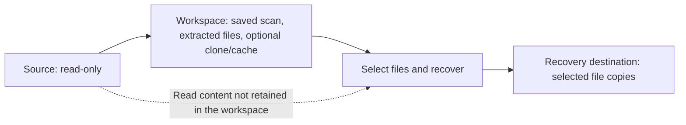

# Open Data Recovery user wiki

This wiki describes the current implementation. Start here for the workflow, then follow the topic pages for details.

| Topic | Questions answered |
| --- | --- |
| [Storage and workspace](storage.md) | Where is data written? Does the workspace contain real files? How much space is needed? |
| [Implemented engines](engines.md) | What does each engine do? Which run automatically, and which require a custom choice? |
| [Scan modes](scan-modes.md) | What exactly runs in Quick, Deep and Full? Can a scan use several engines? |
| [Lost-partition discovery](partition-discovery.md) | How can TestDisk find missing partition boundaries and make them available as scan targets? |
| [Final consolidation](consolidation.md) | How are duplicate findings displayed or grouped? What changes in time, storage and recovery? |
| [Recovering files](recovery.md) | Where do recovered bytes come from? What do the recovery options and verification mean? |

## Start-to-finish workflow

1. **Choose the source.** Select a disk/partition from the sidebar, or add an image, unlocked mapper or mounted folder. The application opens the source read-only.
2. **Choose the workspace.** Device/folder sources require a different physical drive. Image files may share their hosting drive with output folders, provided those folders do not contain the image or its segments. Each scan creates its own saved-scan directory there.
3. **Choose the mode and options.** The main Scan button uses the selected mode, workspace and clone checkbox with default engine options. Use its **Custom…** dropdown for filters, explicit engines and optional consolidation.
4. **Prepare and scan.** E01 conversion, optional cloning and a custom byte-range copy happen before scanning when applicable. Engines run sequentially and save findings and any extracted contents in the workspace.
5. **Finish consolidation, if enabled.** This option is off by default. It compares contents and publishes the final grouped list after scanning finishes.
6. **Inspect and select results.** Search, preview and select files or groups. A listed candidate is not a guarantee that its original contents are intact.
7. **Recover.** Open the review dialog, choose a destination outside the saved-scan directory and set the output options. The same device/image storage rules apply; workspace and destination may share a drive. See [storage examples](storage.md).
8. **Recover and check the files.** Recovery writes the selected copies and records outcomes in the saved scan. Keep the workspace for future use, or remove that saved-scan directory when its contents and history are no longer needed.

Selecting or adding another source does not close the displayed scan. Its results, selection, search and preview remain available. **Results from…** identifies those results, while **Next scan: …** identifies a different source selected for a new scan. Recovery always uses the displayed scan. Start a new scan or explicitly open another saved scan to replace it.

To remove a saved attempt, use **Menu → Scan → Saved Scan → select the scan → Delete…** and review the folder before confirming permanent deletion. See [storage and cleanup](storage.md).

For a missing or damaged partition table, use **Menu → Scan → Find lost partitions…** before the file scan. TestDisk searches read-only; **Use partition** adds a bounded virtual source. Enable **Include existing files** in Custom Scan when recovering files that were lost with the partition. See [partition discovery](partition-discovery.md).

The optional clone is inside the workspace. When available, it can supply the source reads shown above without reconnecting the original source.

## Language settings

The interface supports English, French, Spanish, Simplified Chinese, Hindi,
Arabic and Portuguese. On first launch it follows the desktop language; unsupported
languages fall back to English. **View → Language…** lets you choose a language
or return to **System language**. Apply the choice, then reopen the application
when convenient. Changing this setting does not interrupt a running scan.

The preference is stored in `$XDG_CONFIG_HOME/open-data-recovery/language`, or
`~/.config/open-data-recovery/language` when XDG_CONFIG_HOME is unset. For one
launch, use `ODR_LANGUAGE=fr open-data-recovery` (also `en`, `es`, `zh_CN`, `hi`,
`ar`, `pt`). Without an override or saved preference, ODR considers `LANGUAGE`,
then the first set value of `LC_ALL`, `LC_MESSAGES`, and `LANG`. The `C`/`POSIX`
locale selects English. Regional variants such as `fr_CA` and `pt_BR` use their
supported base language; `zh_CN`, `zh_SG` and `zh_Hans` use Simplified Chinese.

Arabic mirrors the interface. Paths, extension patterns and numeric inputs keep
left-to-right direction. Source names and file contents are never translated.
Menus, dialogs, scan controls, progress and common validation messages are
localized. CLI output, saved data identifiers, engine diagnostics and detailed
technical reports retain their original language. System file chooser internals
follow the desktop's GTK language.

Catalogs are embedded, so language support also works offline and in AppImage.
Text rendering uses system fonts. If Chinese or Hindi characters appear as boxes,
install your distribution's Noto fonts (Debian/Ubuntu: `fonts-noto-core` and
`fonts-noto-cjk`). See the [translation contributor guide](../../src/i18n/README.md).

## Terms used in the application

| Term | Meaning |
| --- | --- |
| Engine / backend | An external tool invoked by an implemented adapter. Installed engines are not necessarily all used by a scan. |
| Finding / candidate | One result from an engine: a path, metadata and either a source location or a retained file. Several findings can describe identical contents. |
| Artifact | A file kept with the scan: extracted content, a report, diagnostic output, or a cache file. Not every artifact is a recoverable original file. |
| Consolidated group | A result representing identical contents, with all member findings and recorded paths retained. Findings without a verified match remain separate. |
| Recovery destination | The output folder for selected final file copies. It is separate from the saved scan. |

**One engine runs at a time, but one scan can run several engines in sequence.** Quick can run several metadata engines; Full adds one carver afterward. Deep runs one carver. Diagnostics and preparation tools have separate supporting roles.

**Metadata-based scanning does not always mean metadata-only storage.** Some metadata engines already extract file contents. Recovery of retained contents creates another copy at the destination; the workspace copy remains.

For implementation and release details, see [consolidation costs](consolidation.md#time-and-storage-costs), [development and validation](../development.md), [CI and releases](../ci-release.md), and [packaging](../packaging.md).
